# 教材图谱 · 中小学数学 / 英语知识图谱与薄弱点诊断

把小学数学到高中数学、小学到高中英语、初中到高中物理、小学语文的**知识点、先修关系、题库和课标条目**整理成一份可查询、可自适应出题的静态数据图谱，并附带一个能沿先修关系往回追的**诊断工具**，用来定位"到底哪一步没学会"。

纯静态站点：没有后端、没有构建步骤、不依赖任何 CDN，克隆下来起一个静态服务器就能用。

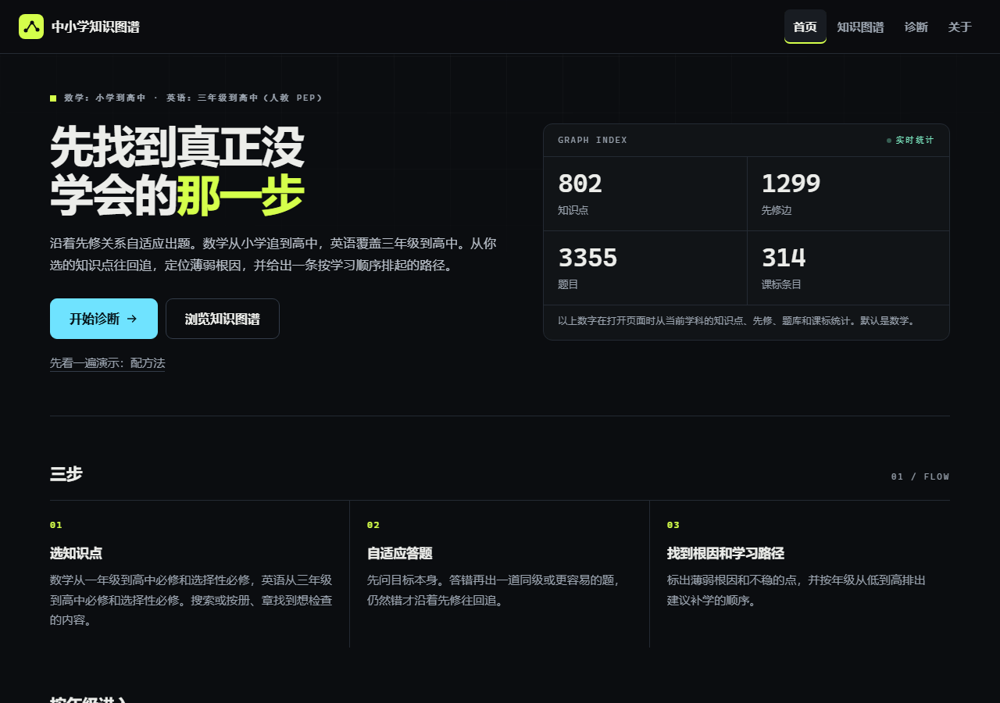

---

## 目录

- [这是什么](#这是什么)
- [快速开始](#快速开始)
- [三个页面](#三个页面)
- [数据规模](#数据规模)
- [数据文件](#数据文件)
- [知识覆盖](#知识覆盖)
- [诊断是怎么判的](#诊断是怎么判的)
- [部署](#部署)
- [可选：打包成单文件桌面版](#可选打包成单文件桌面版)
- [已知局限](#已知局限)
- [来源与许可](#来源与许可)

---

## 这是什么

一个**知识点先修图**加一个**自适应诊断器**。

- **知识点**：2202 个，每个都有 id、年级、册次、章节、领域、描述、掌握标准、课标映射和样题。
- **先修边**：3429 条，分 `hard`（硬先修，不做前面这一步就学不下去）和 `soft`（软先修，教材编排或习惯顺序）。
- **题库**：8955 道，数字题和选择题为主，大部分带机器可校验的 `verify` 表达式。
- **课标**：647 条条文（义务教育数学、高中数学、义务教育英语、高中英语、义务教育物理、高中物理、义务教育语文七套课程标准）。

诊断时选一个目标知识点，工具会先问它本身；答错再出一道同级或更简单的题，仍然错才沿着先修边往回追，最后给出**薄弱的根因**、**不稳的知识点**和一条**按年级从低到高排好的学习路径**。

## 快速开始

页面用 `fetch()` 读取 `data/*.json`，浏览器不允许直接用 `file://` 打开，所以需要一个静态服务器：

```bash
git clone https://github.com/zhujiuyi/jiaocaitupu.git
cd jiaocaitupu
python3 -m http.server 8000
```

然后打开：

| 页面 | 地址 |
| --- | --- |
| 首页 | <http://localhost:8000/> |
| 英语（小学到高中） | <http://localhost:8000/?subject=english> |
| 物理（八年级到高中） | <http://localhost:8000/?subject=physics> |
| 语文（小学） | <http://localhost:8000/?subject=chinese> |
| 孩子档案 | <http://localhost:8000/children/> |
| 错题本 | <http://localhost:8000/mistakes/> |
| 知识图谱 | <http://localhost:8000/explore/> |
| 诊断 | <http://localhost:8000/diagnose/> |

任何静态服务器都可以（`npx serve`、nginx、Caddy 都行），不需要 Node 或 Python 运行时。

## 三个页面

### 首页

数学一至九年级，加上高一（必修第一册）、高二（必修第二册）和选择性必修一 / 二 / 三；英语是小学三到六年级、初中七到九年级，以及高中必修一~三和选择性必修一~四。右上角的统计数字在打开页面时从数据文件里数出来，不是写死的。小学青绿、初中靛蓝、高中品红三色区分学段。

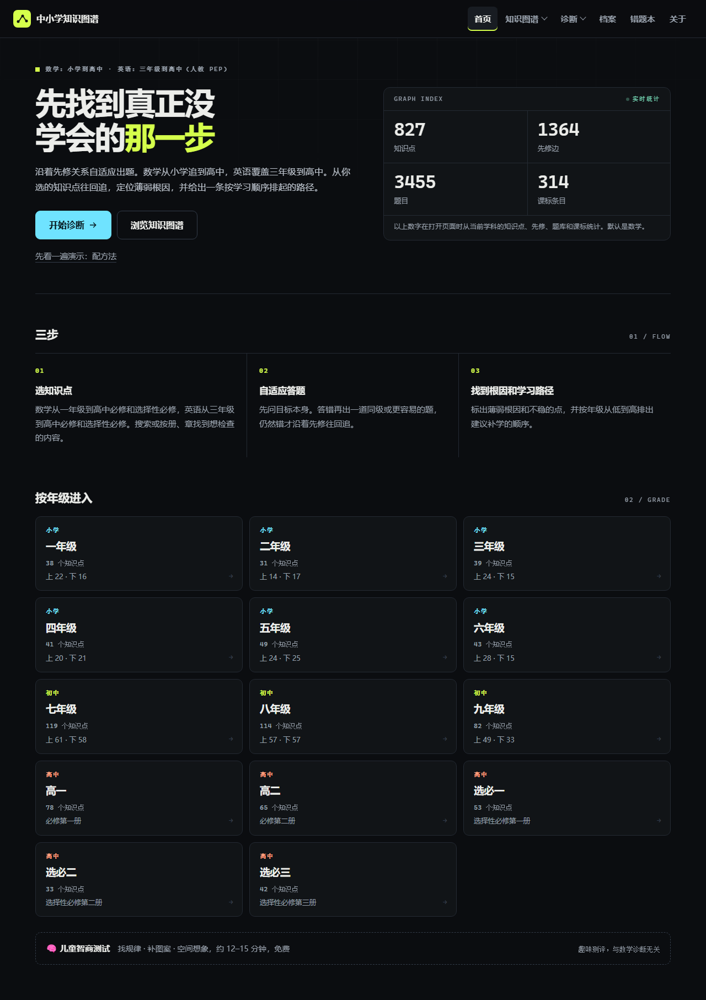

### 知识图谱

左侧搜索 + 学段/年级/领域筛选，目录按"年级 · 册 · 章"折叠；中间用 Cytoscape + dagre 只画**当前知识点附近的局部图**（默认向上 2 层先修、向下 1 层），硬先修实线、软先修虚线；右侧是详情：掌握标准、课标原文、样题、先修列表、"被哪些知识点依赖"。

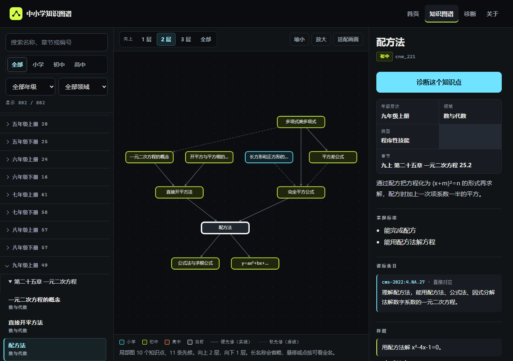

不默认铺开全图——选"全部"且点数超过 40 时会先按年级收起，避免缩成看不清的一团。名称太长在图上会省略，悬停或点按可看全名。

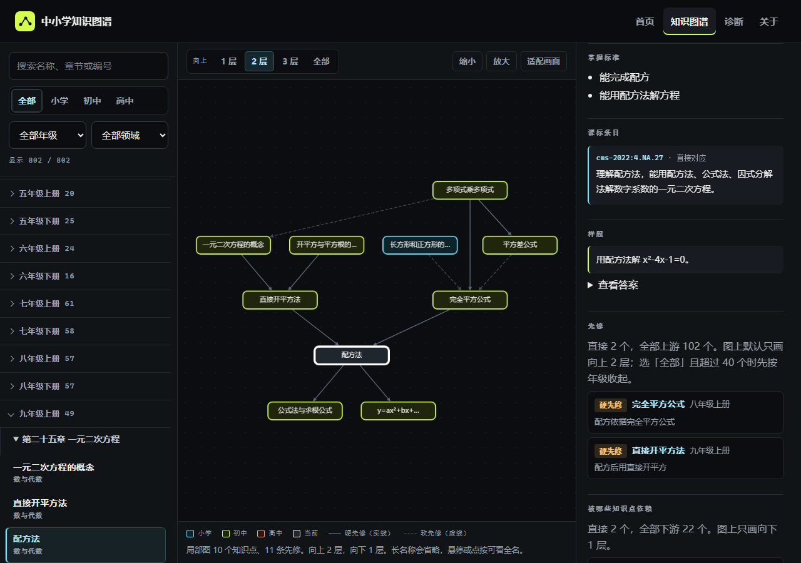

### 诊断

选一个知识点、一整章、一整个年级或一册，开始自适应答题。每题作答后立刻给参考答案和解析；可以把判错的题手动改正。结果页分四块：薄弱的先修知识点（根因）、不稳的知识点、按顺序排好的学习路径、相关课标原文，配一张路径图。进度存本机 `localStorage`，可以导出 JSON、打印或另存为 PDF。

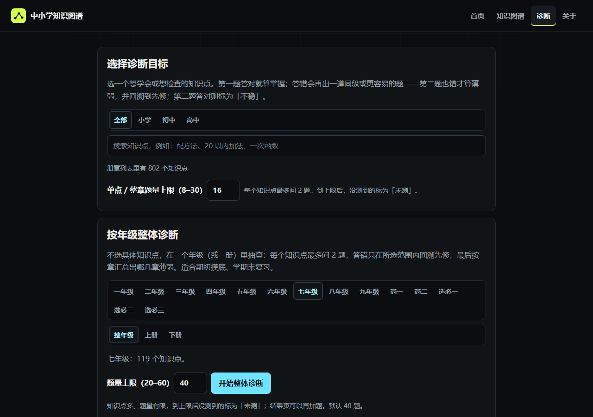

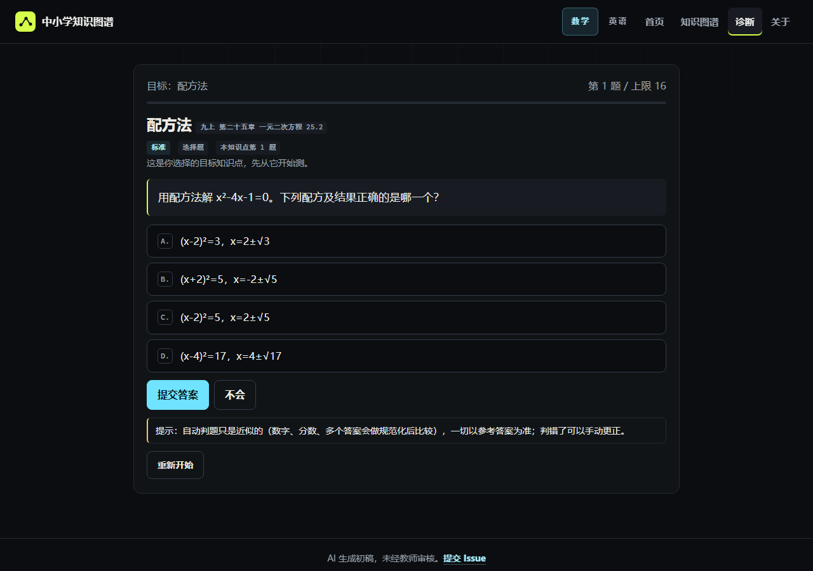

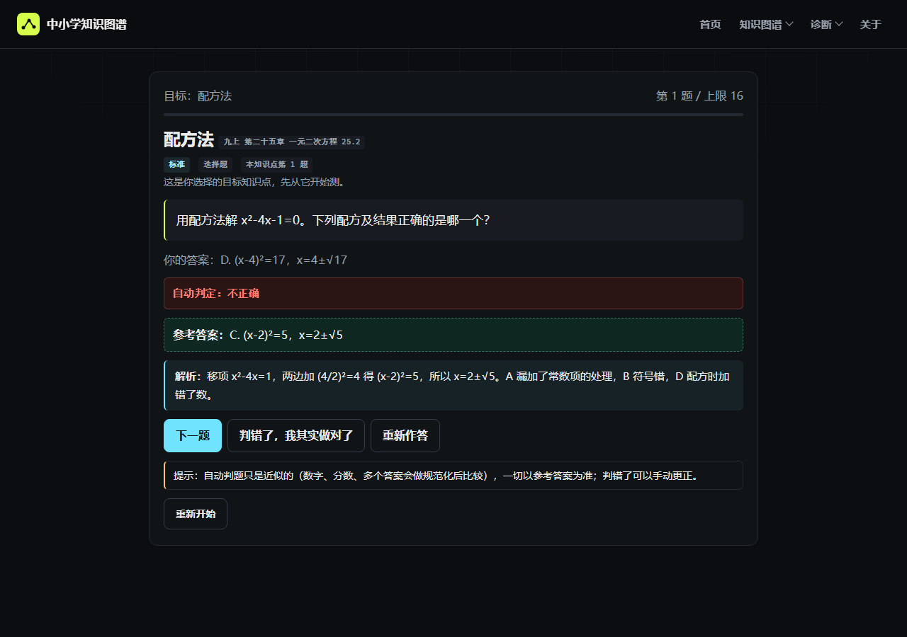

几何题的题干和选项里带内联 SVG 图示，跟随深浅色主题：

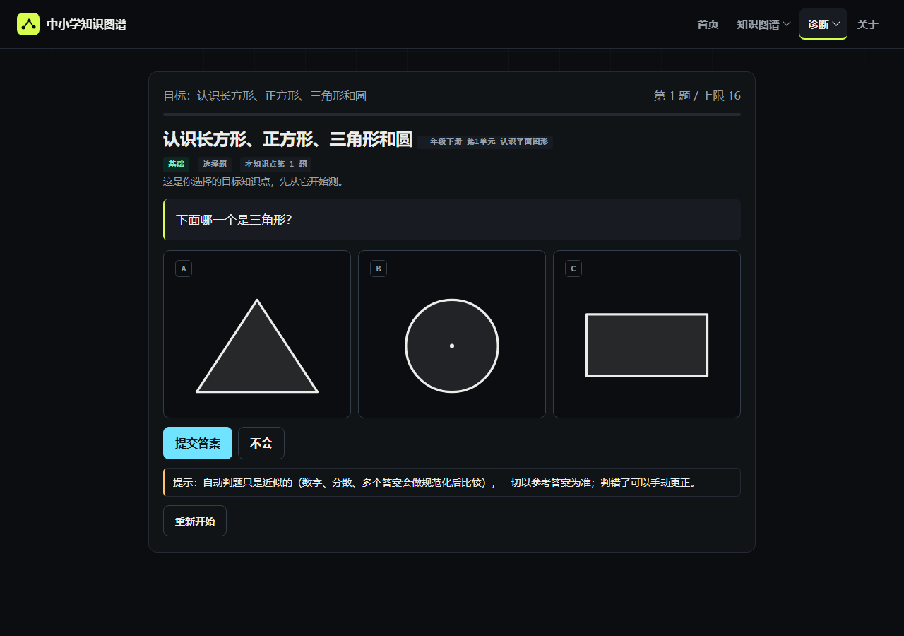

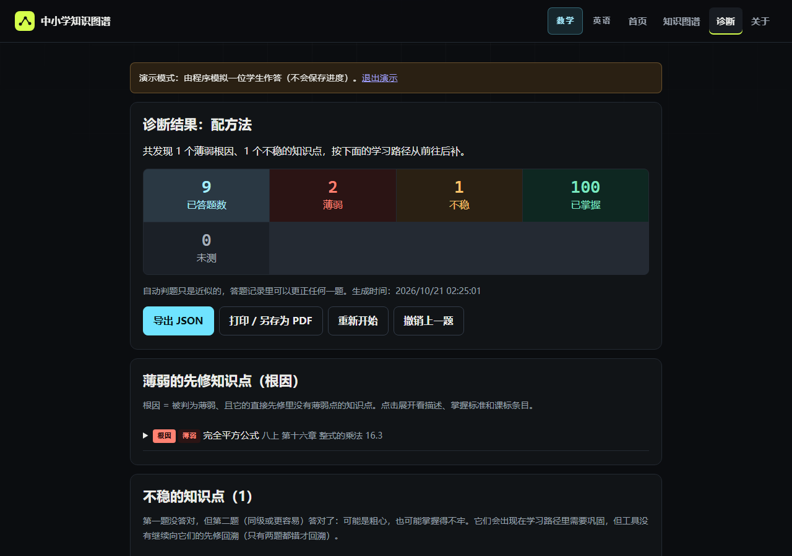

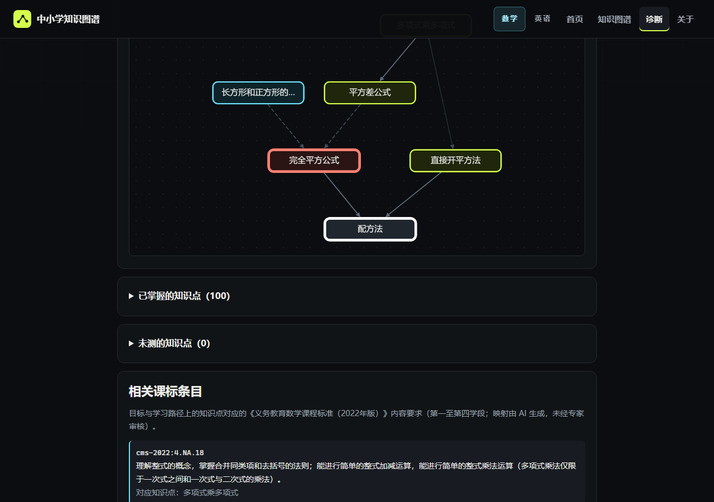

### 英语

`?subject=english` 切到英语：724 个知识点，小学 208、初中 257、高中 259，领域是语音、词汇、语法、日常表达、读写。小学按上 / 下册分，九年级是全一册，高中按必修一~三、选择性必修一~四分册。


初中、高中英语和小学数学共用同一套先修图与诊断流程：

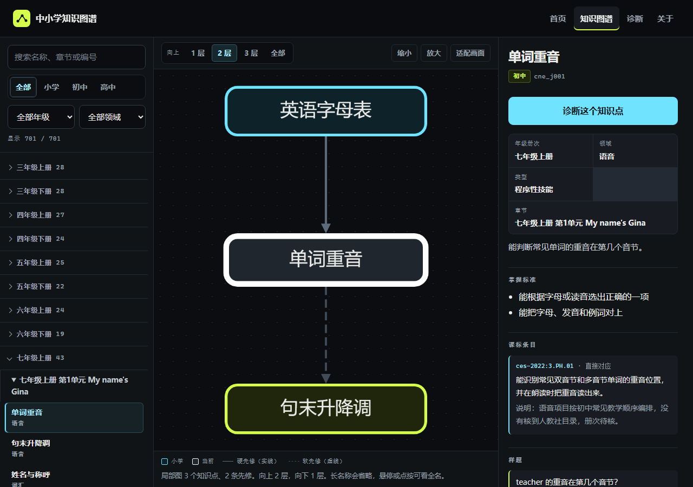

### 物理

`?subject=physics` 切到物理：269 个知识点，初中 92（八年级上册 28、八年级下册 24、九年级全一册 40）+ 高中 177（必修一~三、选必一~三），1076 道题，197 条课标（义务教育 89 + 高中 108）。领域是物质、运动和相互作用、能量、跨学科实践。

物理**和数学分开建图**：`mathLinks` 字段只是提示"这里会用到哪些数学"，不算先修边，诊断时也不会追到数学，避免物理诊断跑到分数运算上一去不回。

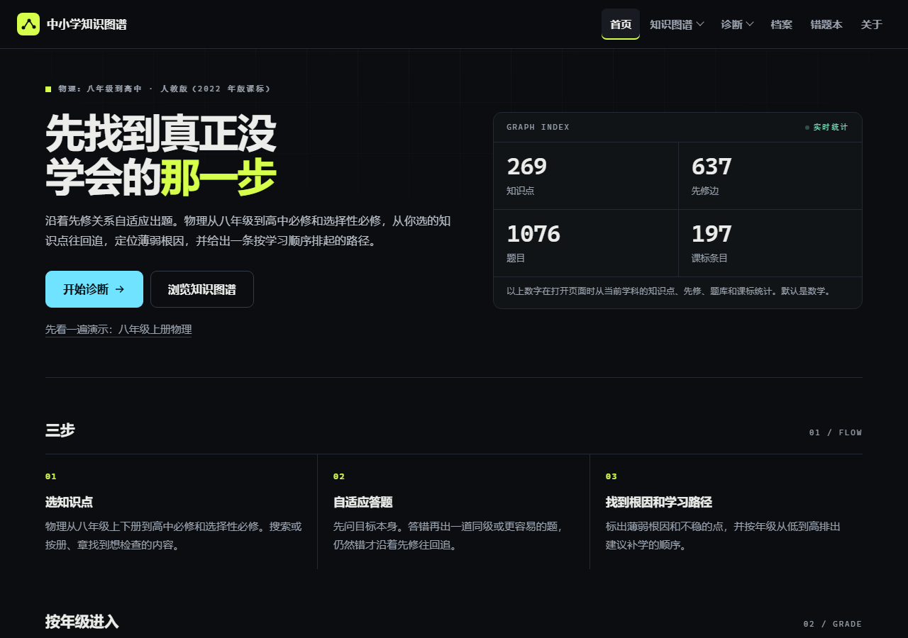

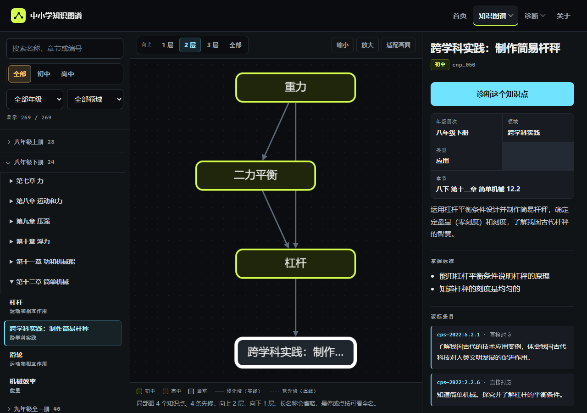

### 语文

`?subject=chinese` 切到小学语文：381 个知识点（一年级 79、二年级 78、三年级 82、四年级 62、五年级 40、六年级 40），1524 道选择题，20 条课标。领域是识字写字、拼音、词语、句子、阅读理解、习作基础、古诗文积累。

按统编版教材逐册、逐单元排列，每册 20–42 个点。语文没有跨学科先修边，先修关系按教材编排顺序生成。

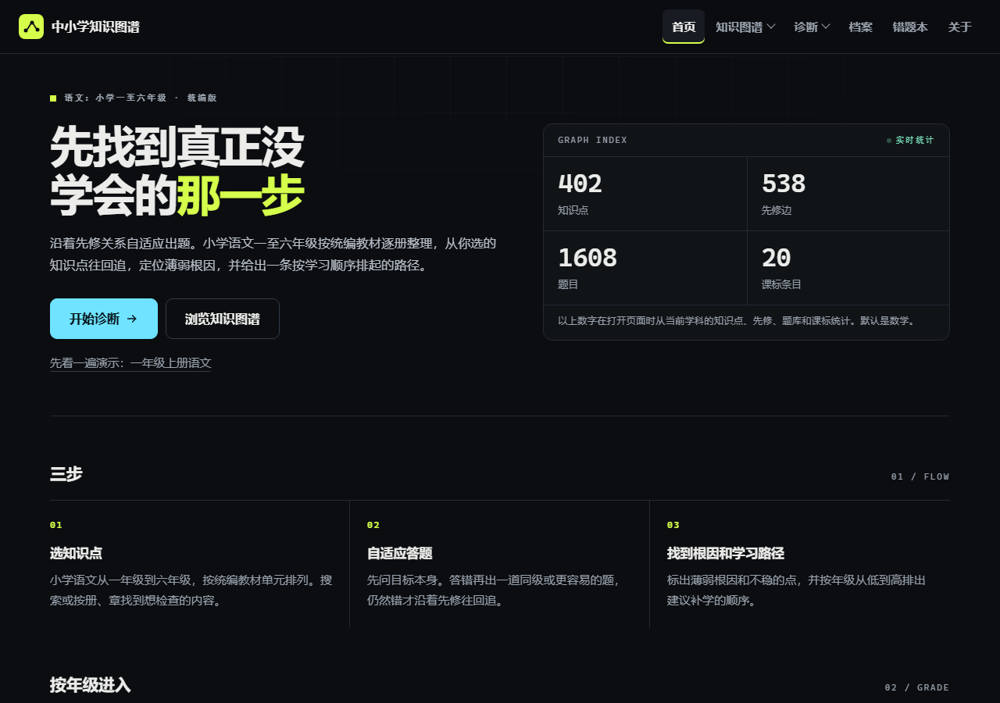

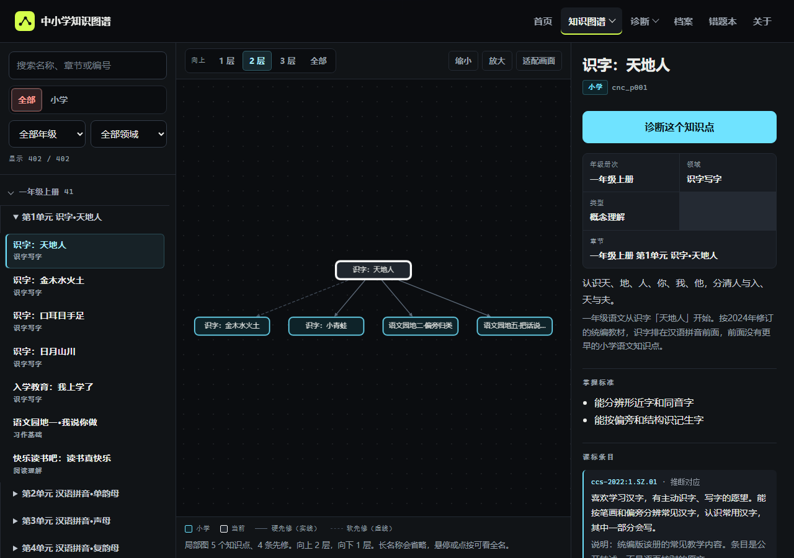

### 移动端

手机上目录收进顶部抽屉，图谱和详情上下堆叠，答题选项的触控区域不小于 44px。

  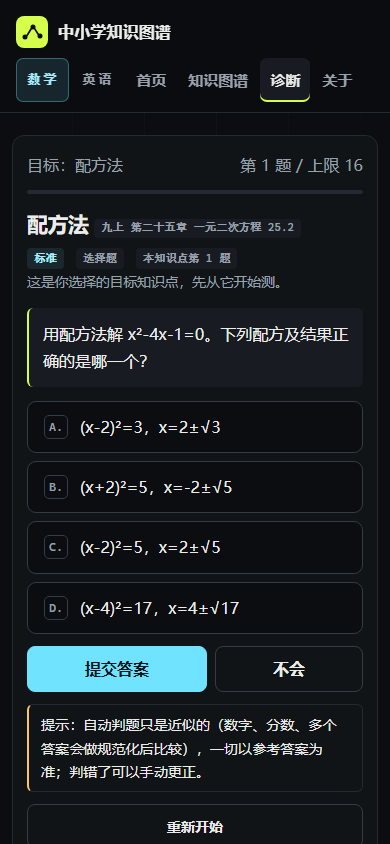

### URL 参数

诊断页支持直接带参数进入，方便分享和复现：

| 参数 | 含义 |
| --- | --- |
| `?target=cnm_221` | 指定目标知识点，可写多个 id（逗号分隔） |
| `?grade=七年级` / `?grade=七上` / `?grade=高一` | 按年级或册整体筛查 |
| `?volume=七上` | 按某一册筛查 |
| `?limit=40` | 本次题量上限 |
| `?demo=1` | 演示模式：程序模拟一位学生作答，直接到结果页，不写存档 |
| `?step=2` | 配合 `demo=1`，只自动答前 2 题并停在出题页 |
| `?seed=abc` | 固定选题随机种子；同一种子 + 同样作答 = 完全一样的出题序列 |
| `?subject=english` | 切到英语（小学 / 初中 / 高中） |

## 数据规模

下表由 `data/*.json` 实际统计得出：

| 项目 | 数学 | 英语 | 物理 | 语文 | 合计 |
| --- | ---: | ---: | ---: | ---: | ---: |
| 知识点 | 828 | 724 | 269 | 381 | **2202** |
| 先修边 | 1366 | 914 | 637 | 512 | **3429** |
| 题目 | 3459 | 2896 | 1076 | 1524 | **8955** |
| 课标条目 | 314 | 116 | 197 | 20 | **647** |

数学部分按学段分：小学 242、初中 315、高中 271。
先修边里 `hard` 1935 条、`soft` 1494 条，跨学段的 117 条。
题目按类型：`numeric` 2672、`choice` 6254、`short` 23、`self` 6；按难度：`basic` 4366、`standard` 4234、`advanced` 355；平均每个知识点约 4.1 题。

## 数据文件

| 文件 | 内容 |
| --- | --- |
| `data/topics.json` | 知识点：id、名称、领域、年级、学期、章节、类型、描述、掌握标准、样题、课标映射 |
| `data/dependencies.json` | 先修边：`topicId` ← `prerequisiteId`，带 `strength`（hard/soft）和理由 |
| `data/questions.json` | 题库：题干、答案、解析、难度、类型，数字题带 `verify` 表达式 |
| `data/cn-curriculum-standards.json` | 课标条文：id 形如 `cms-2022:4.NA.27`，含原文与出处 |
| `data/id-aliases.json` | 旧编号到现行编号的跳转，避免老链接失效 |

这 5 个文件就是页面的全部数据来源（合计约 8.2 MB）。数据是离线生成好后提交进仓库的，站点运行时不需要任何脚本或构建步骤。

## 知识覆盖

| 学段 | 范围 | 知识点 |
| --- | --- | ---: |
| 小学 | 一年级上 – 六年级下 | 242 |
| 初中 | 七年级上 – 九年级下 | 315 |
| 高中 | 必修第一册、必修第二册（页面上的高一 / 高二） | 143 |
| 高中 | 选择性必修一 / 二 / 三 | 128 |
| 小学英语 | 三年级上 – 六年级下 | 208 |
| 初中英语 | 七年级上 – 九年级全一册 | 257 |
| 高中英语 | 必修一~三、选择性必修一~四 | 259 |
| 初中物理 | 八年级上、下 + 九年级全一册 | 92 |
| 高中物理 | 必修一~三、选择性必修一~三 | 177 |
| 小学语文 | 一年级上 – 六年级下（统编版） | 381 |

章节结构按人教（PEP）A 版教材整理。**部分册次和章节号来自第三方来源，未逐册核对人教社官方目录**，详见[已知局限](#已知局限)。

## 孩子档案与错题本

多个孩子共用一台设备时，先建档案再诊断，每个孩子的结果分开记。

> **数据只存在本机浏览器的 localStorage**，没有账号、不上传、不跨设备同步。清除浏览器数据或换设备就没了。

### 孩子档案（`children/`）

- 最多 8 个，昵称不能重名；可编辑、可删除（删除会连带清掉他的错题本）
- 年级和教材是备注，不按版本筛内容
- 诊断前必须先选一个孩子——错题本要按孩子分开记。演示模式（`demo=1`）例外

### 错题本（`mistakes/`）

按**孩子 × 年级 × 学科**分库存——升一个年级就是新的一个本子，旧年级的不会混进来。哪些知识点会进来：

| 诊断结论 | 是否收录 | 记录状态 |
|---|---|---|
| 薄弱（同一知识点两道题都错） | 收录 | `weak` |
| 不稳（一错一对） | 收录 | `shaky` |
| 已掌握（一次就对） | 不收录 | — |

**抽题规则**（点「开始复习」时）：

1. 刚答对过一次、还没确认掌握的知识点（`correctStreak = 1`）**必被抽中**——这是为了尽快确认它到底会不会
2. 其余按权重无放回加权抽样：`薄弱` 基础权重 3.0、`不稳` 1.5，**每答错一次权重 ×1.6**（封顶 12）
3. 错题本总数不足所选数量时，全部用上

**移出规则**：连续两次答对就移出。中间只要答错一次，连续计数清零、权重再加一档。

复习会话用 `screen` 模式跑：范围就是抽出来的这批知识点本身，答错不会回溯到整章的先修，避免复习扩散。

### 按年级分本

错题本跟着孩子档案里的**年级**走：

- 七年级时攒下的错题，切到八年级后是一个全新的空本子；切回七年级还能看到原来那些
- 想查看旧年级的错题本，**去档案页把孩子的年级改回去**即可（界面上不会同时列出两个年级的错题）
- 档案页卡片会提示「其他年级：七年级 6 条（改年级可切换）」，错题本页顶部也会提示当前年级
- 「开始复习」**只抽当前年级**的错题，不会把以前年级的漏洞带进来
- 孩子没填年级时，错题存在「未分年级」这一档里；之后填了年级，两者互不干扰

> **升级说明**：v1.3.1 及更早的错题本不带年级信息。升级到 v1.4.0 时**旧错题本会被清空**（`cnmMistakes.v1` 自动删除），错题从当前年级重新积累。孩子档案本身不受影响。

### 换设备：导出 / 导入

档案页顶部有「导出备份 / 导入备份」。

- **导出**：下载一个 `知识图谱备份-YYYYMMDD-HHMM.json`，里面是全部孩子档案 + 各自错题本，格式 `{ kind: "cnmBackup", version: 2, children: [...], mistakes: { childId: { gradeKey: { subject: {...} } } } }`
- 导入 `version: 1` 的旧备份只会迁移孩子档案，里面的错题因缺年级会被丢弃（会提示丢了多少条）
- **导入**：选文件后先校验（不是本工具的备份、版本过高、数量超 8 个、孩子缺昵称都会被拒），再按情况处理：
  - 本地**没有**档案 → 直接还原
  - 本地**已有**档案 → 弹框问：**确定 = 覆盖**（清空本地按备份还原）、**取消 = 合并**（保留本地，多出来的孩子追加，重名自动加「（2）」后缀）
- 合并时同一条错题若两边都有，取「权重更高、连续答对更少」的那条，避免把更顽固的记录冲掉

### 存储键

| 键 | 内容 |
|---|---|
| `cnmChildren.v1` | `{ current, children: [...] }` |
| `cnmMistakes.v2` | `{ [childId]: { [gradeKey]: { [subject]: { [topicId]: {...} } } } }` |

## 诊断是怎么判的

每个知识点**最多问 2 题**：

1. 先问目标本身。答对 → 判定"掌握"，并直接跳过它的全部先修（不必再问）。
2. 答错 → 再出一道同级或更简单的题。
3. 第二题也错 → 判定"薄弱"，沿着先修边回溯到它的直接先修继续问；`hard` 先修优先于 `soft`。
4. 第二题答对 → 标记"不稳"，**不**继续回溯（会出现在学习路径里，但不当根因）。

学习路径 = 目标 + 全部祖先构成的子图，做稳定拓扑排序（先修在前，同层按 `topics.json` 顺序），所以同样的作答一定得到同样的结果。

**筛查模式**（按年级 / 册）按知识点抽样，每题量有上限（单点 / 整章 8–30，整体 20–60），到上限没测到的标"未测"，结果页按章汇总薄弱情况。

⚠️ 自动判题是近似的：数字、分数、多个答案会做规范化后比较，判错了可以手动更正，一切以参考答案为准。诊断结果是**线索**，不是结论。

## 部署

仓库是纯静态文件，任何静态托管都能用：

- **GitHub Pages**：推到仓库后开启 Pages，源选根目录即可（`.nojekyll` 已就位）。
- **Cloudflare Pages / Netlify / Vercel**：把 `index.html`、`assets/`、`explore/`、`diagnose/` 和 `data/` 里的 5 个文件一起上传。

部署只需要这 22 个文件（约 3.9 MB）；`screenshots/` 只是给 README 用的，不必上传。

## 可选：打包成单文件桌面版

站点是纯静态的，所以很容易套一个桌面外壳做成单个 exe（Windows）：

1. 用 PyInstaller 把 `index.html` + `assets/` + `explore/` + `diagnose/` + 5 个 data 文件一起打进 exe；
2. 启动时在 `127.0.0.1` 上随机端口起一个只读静态服务器（**不能用 `file://`，`fetch` 会被拦**）；
3. 用 pywebview / WebView2 打开 `http://127.0.0.1:<port>/`，`private_mode=False` 让诊断进度能持久化。

这样得到的单文件约 12 MB，依赖系统自带的 WebView2 运行时（Win11 预装，Win10 由 Windows Update 推送）。要让目标机器完全零依赖，就改用 Electron 自带 Chromium，体积会到 90–150 MB。

## 已知局限

- **内容由 AI 生成初稿，未经一线教师审核**。先修边（尤其 `hard` 边和跨学段边）最需要人工过一遍。
- **课标条文未逐页核对官方 PDF**。高中部分全部标 `verbatim: false`，`page_or_ref` 为"待核"；义务教育部分只有第四学段与教育部原文逐条对照过。
- **册次与章节号**：小学部分册次、高中五册目录、部分小节号来自第三方来源，未与出版社官方目录逐一核对。
- **先修边里有教材编排痕迹**：部分边反映的是教材顺序而非严格逻辑依赖，已尽量标为 `soft`。
- **诊断题未用真实学生数据校准**，判题阈值和难度分级都还是初稿。
- 高中必修第二册在数据里标成"高二"，只为让两册各占一个年级，实际通常在高一下讲授。

## 来源与许可

本项目基于 [xiaoyang111222/cn-math-taxonomy](https://github.com/xiaoyang111222/cn-math-taxonomy) 的数据与代码继续整理，页面样式与文档经过重做。感谢原作者的整理工作。

- 数据、题库、代码与文档：[知识共享 署名-非商业性使用 4.0 国际许可协议（CC BY-NC 4.0）](LICENSE)
- ✅ 可免费用于个人学习、教学、研究，可修改再分发，但需署名并注明来源
- ❌ 不得用于商业用途（付费课程、付费 App、机构收费服务、售卖题库等）
- `assets/vendor/` 下的 Cytoscape、dagre、cytoscape-dagre 仍是各自的 MIT 许可，见 `assets/vendor/VENDOR.md`

商用授权请联系原作者。
